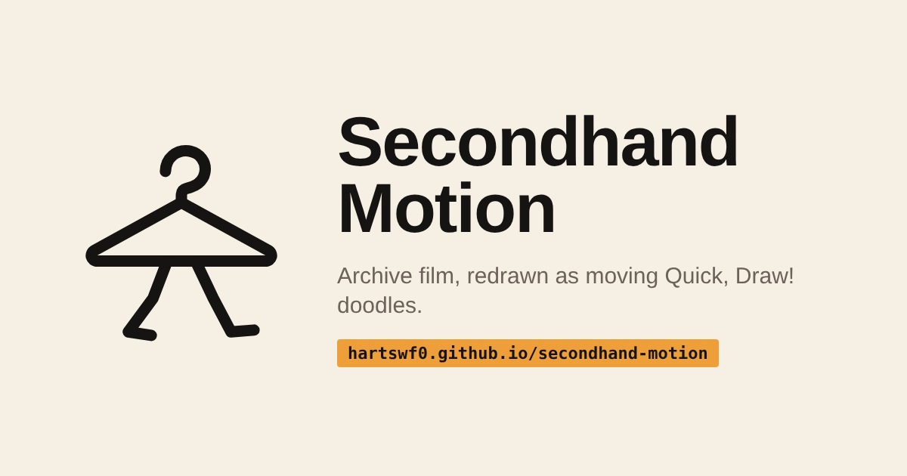

# Secondhand Motion




Any shot in the [Moving Image Archive](https://www.movingimagearchive.com/) should be watchable as a
moving [Quick, Draw!](https://github.com/googlecreativelab/quickdraw-dataset) cartoon: the subject
redrawn in the identity of one real doodle, moving as the footage moves, on depth planes that slide
with the real camera.

Open `index.html` (or the GitHub Pages site): it is **the rack**, every lot of work as a hang tag you can search, filter by kind, lane, status and stage, and switch to a list. Every page works from the file system.

## How the repository grows

- A **lot** is a folder with an `item.json` (lot number, kind, lane, stage, status, cover, links, tests). Subjects and shots live in `shots/<slug>/`; pages and studies in `data/lots/`; batches carry their own. The rack, stage counts and test rack are generated from these files.
- A **test** is an entry in `tests/registry.json` (id, bar, how, stage, which lots it applies to, active or planned). Each lot's `tests.json` holds its results; unrun tests show as not run.
- `python3 tools/new_subject.py "<category>" --wave N` scaffolds a lot from the dataset: archive candidates, a real doodle as cover, every test marked not run.
- `python3 tools/import_batch.py <batch> <traced.json>` turns a look-lane batch into lots and scores what it can.
- `python3 tools/validate.py` checks every lot; `python3 tools/build_pages.py` rebuilds every page (it validates first).
- `python3 tools/style_score.py traced/traced_keys.json` scores M2 on one scale for both lanes; `python3 tools/match_strokes.py traced/traced_keys.json batches/<batch> traced/matches.json` in-betweens traced keys (T3).
- `pages/projector.html` plays every moving lot beside its footage.
- `python3 tools/brand.py` redraws the mark, its thirteen gaits (each lot's hanger walks its own way), favicons and social card.

## Production workbench

Open [production/index.html](production/index.html) for source/drawing comparison, a 100-clip review pool, timed references and drawing budgets. It reuses the existing batch artwork. The next current-10 pass plans 63 more drawings; an extrapolated 100-clip target plans about 990 more from the existing 40. See [production/README.md](production/README.md) for the local agent coordinator and [readthrough](production/docs/repo-readthrough.md) for strengths and unresolved checks.

This pool supplements the category/wave queue; it does not replace it. Source-sample or still-key acceptance never establishes playback approval.

## Start here

- **`PIPELINE.md`**: the 13 stages from archive shot to cartoon, with what each reads, writes and must pass.
- **`AGENTS.md`**: the prompt that hands one subject to an agent. Fill `{CATEGORY}` and `{WAVE}` from
  `data/subject_queue.json`. Critics are separate agents and see only the critic packet.
- **`index.html`**: the rack. **`pages/tests.html`**: every test against every lot.

## Two lanes, and the join

| | Look lane | Motion lane | Join |
|---|---|---|---|
| Where | `batches/2026-10-20-selected-drawings/` | `shots/giraffe-walks-past/` | `tools/trace_keys.py`, `traced/` |
| What | image model draws 4 still keys per subject in the doodle's identity; fresh critics review | vector rig keyed over SAM silhouettes, in-betweened, 6 depth planes, measured camera | raster keys traced to strokes, split into what holds and what moves |
| Status | 10 subjects, 40 keys accepted as stills | 11 of 14 saved test statuses true; several historical assertions; playback review still open | recall ≥ 0.98 on all 40 keys; backgrounds are redrawn per key (fix upstream) |

## Rebuild

```sh
pip install numpy pillow scipy scikit-image markdown
data/quickdraw/fetch.sh                        # exact Quick, Draw! slices the shot scripts read
cd shots/giraffe-walks-past
PRM='{"leg_w":0,"seg":16,"wobble":3,"spots":0,"ossicones":true,"tail":true,"bend":5,"muzzle":7,"tail_len":34,"tuft":true}'
python3 inbetween.py pose_agent_v5.json "$PRM" drawn_frames_v5.json
python3 build_shot.py && python3 tests.py      # shot.json and tests.json rebuild byte-identical
cd ../..
python3 tools/trace_keys.py batches/2026-10-20-selected-drawings traced/traced_keys.json
python3 tools/import_batch.py batches/2026-10-20-selected-drawings traced/traced_keys.json
python3 tools/build_pages.py                   # validates lots, then every page and index.html
```

The browser stages (SAM 2.1, Grounding DINO, CLIP, the Quick, Draw! classifier, all through
transformers.js / onnxruntime-web) and the image-model keys were run interactively; their outputs
are committed. Their scripts are not yet in the repository.

## What has and has not happened

- No model has been trained. Agents proposed, tests and fresh critics judged, ledgers kept every
  attempt. That is search, and it is the data a learner would need later (`PIPELINE.md`, "Where
  learning comes in").
- Still-key approval is not motion approval. No shot has yet passed a playback review.

## Credits

See `ATTRIBUTION.md`. Footage: Moving Image Archive (rights as reported per source record).
Doodles: Quick, Draw! by Google Creative Lab and its contributors, CC BY 4.0.
